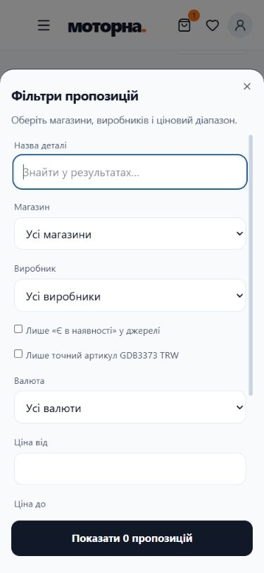

# МОТОРНА

Опублікований застосунок: https://motorna-auto-space.bilogrivijvladislav.chatgpt.site/

Поточна архітектура, джерела, доступ і межі інтеграцій: [ARCHITECTURE.md](ARCHITECTURE.md).

## Що працює
- VIN → підтвердження авто → гараж → симптоми або деталь → пропозиції → фільтри → збережений запит на купівлю. Деталі: [JOURNEY.md](JOURNEY.md).
- VIN: хмарний знімок відкритих реєстраційних даних МВС, далі NHTSA vPIC; додаткові часткові джерела потребують підтвердження. Відсутні характеристики не вигадуються. Реєстр не є заводським каталогом комплектації.
- Реальні пропозиції з доступних сторінок магазинів; точний артикул відокремлений від непідтвердженої сумісності за VIN. Демонстраційні товари позначені й не додаються в запити.
- Гараж, пробіг, витрати, чеки, PDF/Excel та відкличний QR-каталог з вибірковим доступом до документів.
- Наступне ТО: дата та/або пробіг. Нагадування показане в гаражі за першою досягнутою межею. Пробіг вводиться власником; автоматичних push/SMS немає.
- Діагностичний діалог на правилах, не LLM. Пояснення OBD: P0300–P0309, P0299, P0128, P0420; невідомі коди не розшифровуються навмання. Джерело визначень: https://www.boschdiagnostics.com/sites/default/files/documents/OBD1000%2520MNL%2520Rev%2520A%2520Bilingual-Codes.pdf . Коди не підтверджують потреби заміни деталі.
- Пошук СТО по Україні від обраної адреси. Дані, телефони, графік — лише коли доступні в джерелі. Оцінки MOTORNA окремі від зовнішніх рейтингів.

## Межі продукту
Немає ліцензійного OEM-підтвердження, гарантованого охоплення всіх магазинів, календарів партнерських СТО, оплати чи автоматичного надсилання запитів. Запит — приватна чернетка, яку власник передає продавцю сам. Знімок МВС у хмарі не оновлюється автоматично; локальний імпортер працює окремо. Закриті джерела не обходяться.

## Розробка

React/Next.js через Vinext, TypeScript, Cloudflare D1/R2. Пакет вимагає Node.js >=22.13.0; CI та перевірене локальне середовище використовують Node.js 24.

```sh
npm ci
node scripts/prepare-ci.mjs
npm run dev -- --host 127.0.0.1
```

Для чистого публічного клону `prepare-ci.mjs` створює лише відсутній ігнорований маніфест локальних DB/BUCKET. Він не додає production-ідентичність чи секрети. Використовуйте адресу з виводу dev-сервера. Локальна база та production ізольовані; `.openai` і секрети не копіюються в GitHub.

## Автоматизовані перевірки

```sh
npm run lint:strict
npm run typecheck
npm test
npm run build
```

`npm run lint` і `npm run lint:strict` обидва виконують `eslint .`. Перевірка 07.11.2026: **0 помилок, 65 попередження, exit code 0**. Baseline немає; `--max-warnings=0` не використовується, тому попередження не блокують перевірку. Залишаються попередження про невикористаний код, залежності React hooks, звичайні img та навігацію. Правила й винятки для сторонніх UI-компонентів не змінювалися для отримання цього результату.

`npm test` запускає **32 регресійні набори** без зовнішніх мережевих залежностей. Playwright містить **14 сценаріїв у двох профілях — 28 тестів**. Команди, сценарії та межі фікстур: [TESTING.md](TESTING.md).

CI у `.github/workflows/ci.yml` виконує встановлення, `lint:strict`, typecheck, регресії, build, Playwright і локальний API-сценарій на Windows/Node.js 24. Workflow не публікує сайт і не потребує production-секретів. Налаштований workflow сам по собі не є доказом успішного віддаленого запуску.

Мобільні фільтри (локальна перевірка, порожній результат не замінюється демотоварами):



Playwright охоплює desktop/mobile, контрольований збій джерела, ізоляцію QR-каталогу, пагінацію, Origin/CSRF і формат API-помилок.

## Перевірки перед релізом
`/api/health` перевіряє читання D1 і доступ до R2 без повернення персональних даних: 200 зі status=ok або 503 із code=HEALTH_DEGRADED та станом перевірок у details. Це точкова перевірка, не довготривалий моніторинг чи гарантія uptime. Сповіщення ще не налаштовані.

Завантаження PDF/JPG/PNG перевіряє сигнатуру й фактичний обсяг multipart-потоку. Це не антивірус і не повна перевірка структури PDF/зображення. Документи приватні до явного включення в QR-каталог. Маршрутні тести контролюють ізоляцію A/B, доступ до приватних файлів та відмову збереженому URL документа після відкликання QR.

Стан релізних критеріїв і обмеження перевірки: [RELEASE.md](RELEASE.md).

## Підготовлена міграція грошей

Money-v2: цілі minor units і явна валюта, dry-run на копії, SQLite/D1-пакети та відкат. Це підготовка, не перехід робочого застосунку: [MONEY_MIGRATION.md](MONEY_MIGRATION.md).

## VIN Intelligence & photos

See [provider configuration, rights, API, storage and verification](docs/VIN_INTELLIGENCE.md). Private per-car gallery, strict source-VIN evidence, licensed model illustrations and owner uploads; commercial sources default off.

Keyless public photo search is restored: Google/DuckDuckGo discovery and supported public listing pages, with strict VIN/model separation, source links and honest blocked/empty states. This does not activate official commercial APIs. See the restored-search section in the guide above.
